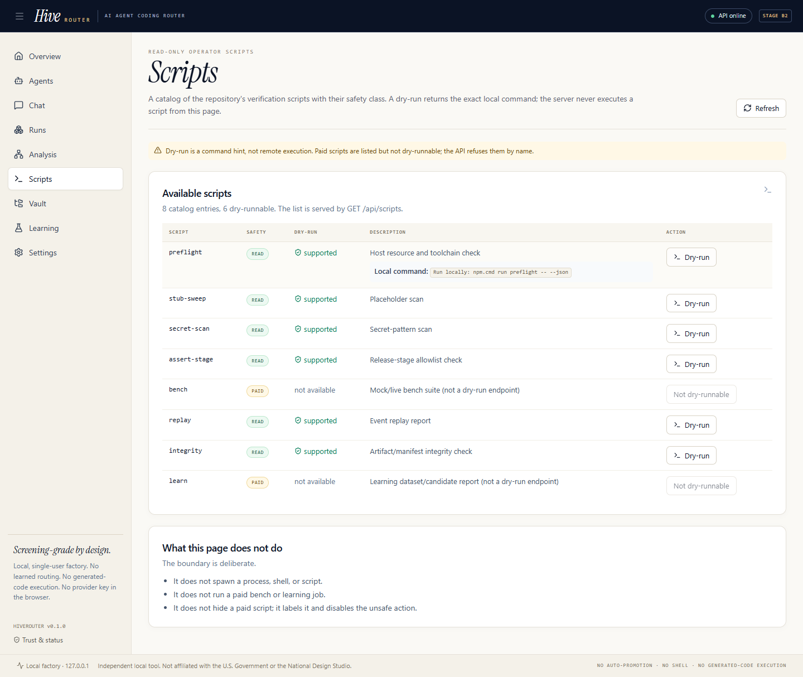
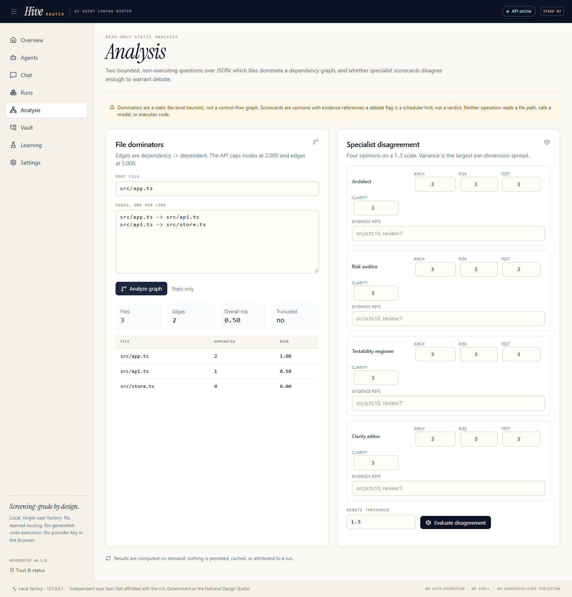
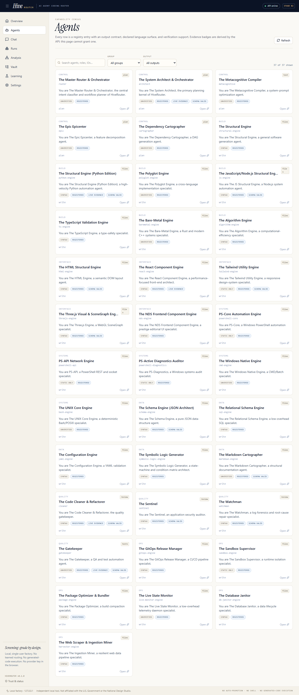
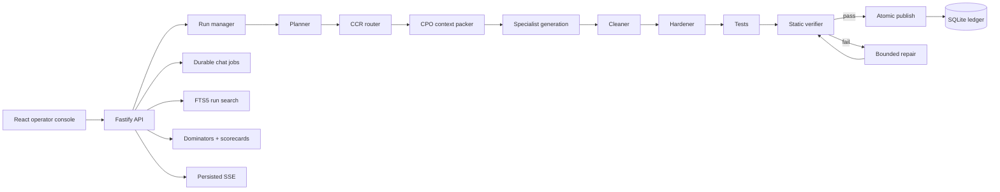

# HiveRouter

**A local-first, truth-first code factory for the DeepSeek API.**  
Plan a project, route each file to a specialist role, generate, statically verify, repair, and inspect the ledger — without pretending a failed gate passed.

<p>
  
  
  
  
  
  
  
</p>

HiveRouter is a personal engineering showcase built around one rule: **evidence or it did not happen**. It is a real, runnable TypeScript application — not a slide deck — with a deterministic routing engine, a persisted run ledger, static verification, a staged-artifact safety model, chat fan-out, full-text run search, and honest refusals when a capability is absent.

It is deliberately **not** an autonomous agent runtime. Generated code is never executed. There is no shell tool, no Docker sandbox, no auto-promotion, and no claim that a static check proves correctness.

---

## Why this project exists

Most “AI code generator” demos look impressive until you ask three questions:

1. What happens when verification fails?
2. Can a retry double-charge or lose a write?
3. Does the UI show the same thing the database recorded?

HiveRouter is built around those questions. Failed runs retain staged artifacts; unknown provider usage is stored as unknown, not zero; terminal states are guarded; the event feed has a persisted ledger; and every paid path is budget-capped.

The goal is not “AGI writes your app.” The goal is a **small, inspectable factory** where the limits are visible and the evidence is reproducible.

---

## Screenshots

### Scripts: read-only catalog, explicit safety classes, command-hint dry-runs



### Static analysis: dependency dominators and specialist disagreement



### Agent registry: 37 declared roles with real capability labels



---

## What it does

```text
brief
  → plan (file graph, interfaces, duties)
  → route (capability filters, cost/latency/risk utility, micro-USD budget DP)
  → context pack (PageRank + token-budgeted CPO)
  → generate (specialist role, whole-file output)
  → clean → harden → test → static verify
  → repair loop (bounded)
  → review gate
  → atomic publish
  → persisted ledger + SSE + evidence
```

A run can stop at several named states — including **failed**, **cancelled**, **budget-exceeded**, **interrupted**, and **completed-with-warnings** — and it cannot be quietly upgraded to success.

### Core capabilities

| Area | What is real |
|---|---|
| Routing | File-level CCR with capability filters, static priors, cost/latency/risk utility, micro-USD budget DP, deterministic seeded ties |
| Context | PageRank over the file graph, 1-token knapsack units, CJK-aware estimates, stable prefix hashes |
| Verification | Python AST, TS/JS/JSX transpile diagnostics, JSON, YAML, non-executing SQL shape checks, HTML; unsupported languages are **unverified**, never passed |
| Safety | Prompt-injection envelopes, path safety, secret scan, stub scan, critical review findings fail the gate |
| Persistence | SQLite WAL, run/step/check/artifact/review/usage ledger, idempotency keys, compare-and-swap status guards |
| Failure handling | Budget reservations, `null` for unknown usage, staged failed artifacts, bounded repair loop, terminal-state protection |
| Resume | Re-verify and publish retained **staged** files as a child resume run without another provider call; full mid-run checkpoints are still absent |
| UI | React 19/Vite 8 operator console: runs, agents, chat, vault, settings, learning refusal state, analysis, scripts, run search |
| Run search | Disposable FTS5 trigram index over a terminal run’s published text files; pathless API, staged files excluded |
| Chat | Durable `chat_jobs` with leases, retries, cancellation, SSE projection, and bounded history |
| Learning | P7 scaffolding exists but is **refused** in this build: no sealed 390-case pool and no consent |

---

## Architecture



**Stack lock:** TypeScript, Node 26.7, Fastify 5, React 19, Vite 8, Tailwind 4, `node:sqlite`, direct DeepSeek Chat Completions. No Next.js, Electron, Python backend, OpenAI SDK, or Docker runtime.

---

## Engineering highlights

These are the parts worth reviewing:

- **Deterministic routing.** Micro-USD DP allocation with a reserve, candidate rejection reasons, and constant normalizers so a cheap model cannot win merely because the per-task cost range was narrow.
- **Truthful usage accounting.** Unknown provider usage commits the reservation with `null`; terminal rows distinguish measured from unmeasured spend. No backfilled fabrication.
- **Atomic publish.** A complete tree is built beside the live workspace, then swapped; a DB/vault failure rolls back the publish rather than leaving a completed-looking half-tree.
- **Idempotent chat.** Thread-scoped keys plus request-body hashes prevent a retry from duplicating answers across threads. History is selected newest-first and always keeps the current user turn, even when the thread exceeds its character budget.
- **Agent doctrine.** All 37 role prompts carry the same anti-fabrication rules: no invented imports/endpoints/commands, fail closed on missing information, and preserve assigned paths/interfaces. Prompt version is `2026-11-04.1`.
- **Staged-file resume.** A failed run's retained files can be re-verified and published as a child resume run with no additional model call; mid-run checkpointing is still absent.
- **Bounded static analysis.** Dominators and scorecards are read-only JSON endpoints with explicit limits and a real UI, not decorative cards.
- **Scripts without execution.** The Scripts page lists every verification script with its safety class; a dry-run returns a local command string and never spawns a process. Paid scripts are labeled and disabled, and the API refuses them with `E_SCRIPT_DRY_RUN_UNSUPPORTED`.
- **FTS5 without path traversal.** Search indexes only one terminal run’s published text files; it never accepts a caller-supplied path.
- **Tests as a contract.** 438 unit/integration tests, 30 Playwright tests, stage allowlists, OpenAPI response pins, secret scan, and a stub sweep.

---

## What this is — and what it is not

**This is:**

- a local, single-user code factory;
- a deterministic routing and verification pipeline;
- an operator console over a persisted run ledger;
- a showcase of failure-first engineering.

**This is not:**

- an autonomous tool-using agent runtime;
- a Docker sandbox or remote execution platform;
- a multi-user or cloud service;
- a P7 promotion/evaluation system with data;
- proof that generated code is correct or secure;
- a replacement for human review.

The 37 “agents” are **one-shot prompt personas** with declared output kinds and path globs. They are not separate tool-using processes.

---

## Quick start

### Requirements

- Node.js **26.7.x**
- npm **11.19.x**
- A DeepSeek API key for live generation
- Windows: use `npm.cmd` (the PowerShell shim is blocked by execution policy)

```bash
git clone https://github.com/RodneyDanger1/HiveRouter.git
cd HiveRouter
npm ci
```

Create `.env.local` from `.env.example` and set your key locally:

```dotenv
DEEPSEEK_API_KEY=your-key
DEEPSEEK_BASE_URL=https://api.deepseek.com
DEFAULT_MODEL=deepseek-flash
HOST=127.0.0.1
PORT=8787
HIVE_PHASE=B2
MAX_RUN_COST_USD=0.50
```

Never commit `.env.local`. The key is read server-side only; the browser never receives it.

```bash
npm run build
npm start
# open http://127.0.0.1:8787
```

The SQLite database, workspaces, and vault live under `data/`, `workspace/`, and `vault/` (all ignored by Git).

### First-run checks

```bash
npm run typecheck
npm test
npm run build
npm run e2e
npm run preflight -- --port 0 --json
npm run assert-stage -- --stage=p7 --json
```

---

## Verification

| Gate | Observed |
|---|---|
| Unit / integration | `npm.cmd test` — **438 tests / 69 files** |
| Typecheck / build | `npm.cmd run verify` — **exit 0** |
| Browser E2E | `npm.cmd run e2e` — **30 / 30 passed** |
| Stage allowlist | **199 files / 50 tables / 62 routes / 24 scripts**, violations `[]` |
| Preflight | **PASS** — free RAM 3.13 GB, disk 9.12 GB, Chrome/Node/npm/port |
| Stub sweep | clean (103 files) |
| Secret scan | clean (197 files) |

Reproduce:

```bash
npm.cmd run verify
npm.cmd run e2e
npm.cmd run assert-stage -- --stage=p7 --json
npm.cmd run preflight -- --port 0 --json
```

No paid live call is required for the normal test suite. `test:live` is opt-in and budget-capped.

---

## Useful commands

| Command | Purpose |
|---|---|
| `npm run dev` | Server + Vite dev server |
| `npm start` | Serve the built app and API |
| `npm test` | Unit/integration tests |
| `npm run e2e` | Playwright browser suite |
| `npm run verify` | Typecheck + tests + build + stub/secret sweeps |
| `npm run assert-stage -- --stage=p7 --json` | Release allowlist gate |
| `npm run preflight -- --port 0 --json` | Host/runtime preflight |
| `npm run bench -- --mock` | Mock benchmark |
| `npm run eval:router -- --fixture` | Router evaluation fixture |
| `npm run repo-map -- --run <id>` | Run repository map |
| `npm run context:report -- --run <id>` | Context pack report |
| `npm run integrity -- --run <id>` | Artifact integrity check |
| `npm run learn -- --dataset <f> --candidate <f>` | P7 learning command (refuses without data/consent) |

API docs: `http://127.0.0.1:8787/api/docs`  
OpenAPI: `http://127.0.0.1:8787/openapi.json`

---

## Selected API surface

| Method | Path | Notes |
|---|---|---|
| `GET` | `/api/health` | Phase, DB, key presence, workspace |
| `GET` | `/api/runs` | Server-filtered run ledger |
| `GET` | `/api/runs/:id/snapshot` | Run, steps, checks, artifacts |
| `GET` | `/api/runs/:id/events` | Persisted event ledger |
| `POST` | `/api/runs/:id/search` | Bounded FTS5 search over published files |
| `POST` | `/api/runs/:id/resume` | Re-verify retained staged files as a child resume run (no provider call) |
| `GET` | `/api/analysis` | Self-described static-analysis capabilities |
| `POST` | `/api/analysis/dominators` | File-level dominance/risk |
| `POST` | `/api/analysis/scorecards` | Specialist disagreement hint |
| `GET` | `/api/scripts` | Read-only script catalog with safety class and dry-run availability |
| `POST` | `/api/scripts/:id/dry-run` | Returns the local command or a named refusal; never executes |
| `GET` | `/api/learning/overview` | Truthful refusal when no sealed pool/consent |
| `POST` | `/api/chat/threads/:id/messages` | Idempotent multi-agent fan-out |

All mutation boundaries validate input and return named `E_*` refusals with actionable hints.

---

## Repository map

```text
src/server/        Fastify API, run pipeline, ledger, verification, routing, chat, search
src/shared/        Shared contracts, run events, refusals, algorithms
web/src/           React operator console
test/              Vitest unit/integration tests
e2e/               Playwright browser tests
docs/              Architecture, capability matrix, stop-work flaws, plan, provenance
scripts/           Preflight, stage gate, sweeps, reports, CLI utilities
config/releases/   A / B1 / B2 allowlists
docs/screenshots/  README screenshots
```

Key documents:

- [Architecture](docs/ARCHITECTURE.md)
- [Capability matrix](docs/CAPABILITY-MATRIX.md)
- [Stop-work flaws](docs/STOP-WORK-FLAWS.md)
- [Plan](docs/PLAN-v3.md)
- [Wave 8 live trials](docs/TRACE/WAVE-8/TRACE-SUMMARY.md)
- [Wave 9 tab audit and fixes](docs/TRACE/WAVE-9/TRACE-SUMMARY.md)
- [Backlog and test matrix](docs/BACKLOG.md)
- [Provenance](docs/PROVENANCE.md)

---

## Status and roadmap

**Current:** local B2 build; deterministic routing, static verification, run ledger, chat, analysis, scripts catalog, run search, and staged-file resume are implemented and tested. Preflight passes on this host.

**Not implemented yet:**

- external repository indexing and read-only repo tools;
- a DeepSeek tool-call loop and tool allowlists;
- a P7 evaluator with a sealed case pool and consent;
- full mid-run checkpoints and bounded parallel generation;
- approval/`needs_review` flow;
- patch/compaction/isolation-branch wiring into the run pipeline;
- weighted CPM and full context projection provenance.

These are listed as unfinished on purpose. The capability matrix distinguishes **works**, **API only**, **module only**, and **absent**; it does not turn a stub into a feature.

---

## Safety posture

- No generated code execution.
- No shell tool.
- No provider key in the browser or logs.
- No auto-promotion.
- No historical spend fabrication.
- No arbitrary path from a search or analysis request.
- Local-only HTTP surface by default (`127.0.0.1`).

---

## Notes

HiveRouter is an independent local project. It is not affiliated with the U.S. Government, the National Design Studio, or DeepSeek. Product names are used descriptively.

If you are reviewing this as a portfolio project, start with:

1. `docs/STOP-WORK-FLAWS.md` — what was wrong and what remains wrong.
2. `src/server/runs/recorder.ts` — ledger and terminal truth.
3. `src/server/pipeline/run.ts` — pipeline, staging, and atomic publish.
4. `src/server/verify/` — static verification boundaries.
5. `test/unit/p0-truth.test.ts` — the pins behind the truth claims.
