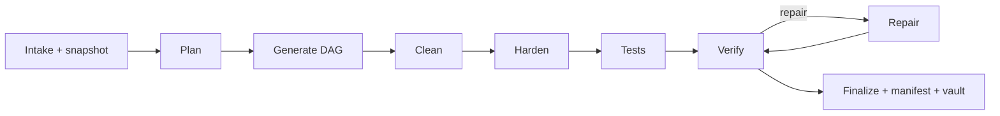
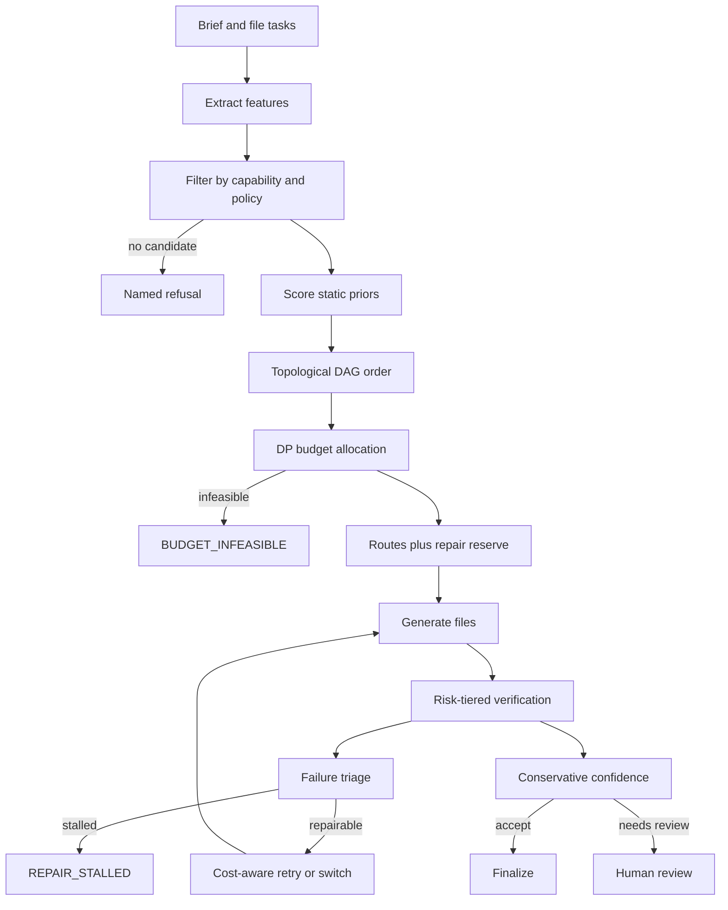
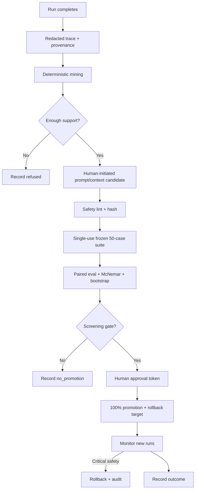

# HiveRouter — Build Plan v2 (Consolidated, Red-Teamed, With Learning & Decision Intelligence)

**Status:** approved plan. v2 supersedes v1. It keeps v1's core design and adds the requested learning loop, two additional loops, five custom algorithms, one major router, four pure logic modules, and seven operational scripts — with the independent watchdog's staging, statistics, provenance, and safety corrections applied.

**Source inputs (read-only):** the two referenced files in `OmniScript Language\00-ORIGINAL-RESEARCH` and `Downloads`, the 37-agent catalog in the request, and the seven research seats' findings. The OmniAgent/OmniScript trees are out of scope and will not be modified.

**Watchdog verdict (final):** Release A **GO**; P6a **GO**; P7 **GO conditional** on one P0 — single-use frozen evaluation suites to control alpha across candidates. This plan closes that P0 by refusing suite reuse and re-freezing from a sealed pool after every evaluation (promotion or no-promotion). No fake learning is permitted: if the evidence is insufficient, P7 records `refused` or `no_promotion` and the baseline stays active.

---

## 0. AI IMPLEMENTATION CONTRACT — READ FIRST

You are implementing HiveRouter exactly as specified. Read every section before coding.

1. **Work only in `C:\Users\Riley\Desktop\HiveRouter`.** Create it fresh. The source files are references; do not edit them or the DSH profile/config.
2. **Stack lock:** TypeScript + Node 26 + Fastify 5 + React 19 + Vite 8 + Tailwind 4 + LangGraph.js 1.6 + `node:sqlite` + DeepSeek Chat Completions. No Next.js, Electron, Python backend, OpenAI SDK, LangChain Python, cloud DB, or second web framework. No new runtime dependencies without amending this plan. Exact pins include `parse5@8.1.0`, `diff@9.0.0`, `@langchain/langgraph@1.6.0`, `@langchain/core@1.3.4`, `zod@4.6.7`, `typescript@5.9.3`.
3. **Release staging is mandatory.** Release A = P0–P5 only. It contains **zero** P6/P7 tables, routes, pages, or scripts. P6a = deterministic intelligence. P7 = learning system. Do not smuggle later-phase code into earlier migrations or UI.
4. **Quality bar:** production code only. No TODO/FIXME/stub/mock data in `src/`. Test doubles only under `test/` and `e2e/`. Never fabricate success. A failed gate or a `no_promotion` result is a valid outcome; a fake green is not.
5. **Secrets:** never print, log, commit, paste, or send the DeepSeek key to the browser. The DSH credential store is read **only after explicit first-run consent**; env/app key sources are supported. Run `redact()` on every event, log, dataset, and error. If a key reaches a file or log, stop, report, and rotate.
6. **LLM output is untrusted:** Zod at every boundary, path validation, no execution of generated code, no auto-promotion, no auto-apply.
7. **Windows:** use `npm.cmd` / `cmd /c npm`; `npm.ps1` is blocked. Do not change execution policy. Pin and commit `package-lock.json`.
8. **Evidence:** every phase ends with the listed gate; quote command and output. Do not proceed on red. P7 must stop honestly if the sealed suite/pool cannot be built.
9. **Team:** disjoint write scopes in §19. Lead owns final integration, diff review, and gates. Teammates return evidence, not claims.
10. **Traceability:** one artifact = one primary type (LOOP / ROUTER / ALGORITHM / LOGIC / SCRIPT / INFRA). No double counting. The matrix in §21 is the count of record.

---

## 1. What changed from v1 (authoritative amendment)

v1 §§1–19 remain in force except as amended here. The amendments are:

- **Core safety fixes:** immutable run snapshots, global budget ledger, bounded SSE, repair stall detection, capability badges, wire-body contract tests, prompt-transform fixtures, exact pins, finish-reason handling, event-only replay, migration/retention tests, audit preset, named refusals, first-run DSH consent.
- **New P6a:** deterministic capability/cost/risk DAG router (CCR), context packer (CPO), failure signature/triage (FSN), risk-tiered verification scheduler (RVS), conservative confidence/abstention (CCA), cost-aware retry allocator (CRA), four pure logic modules, five operational scripts.
- **New P7:** real learning loop (L1), repair-memory loop (L2), guard loop (L4); frozen deterministic context ranker (L3, not a learning loop); two learning scripts; learning UI/API/DB; human-gated promotion/rollback with screening-grade statistics.
- **Removed/deferred:** learned route quality, shadow/live exploration, isotonic calibration, canary traffic, route-policy learning, auto-promotion, 12-script sprawl, P6b/P8. The UX seat's extra `doctor/stats/export/prune/backup/migrate` commands are folded into existing scripts/settings or deferred.

---

## 2. Verified corrections (deepseek-mechanisms + truthseeker)

These correct v1 assumptions. Do not implement the superseded versions.

| v1 assumption | Correction | Action |
|---|---|---|
| Chat Completions supports `json_schema` | Only `json_object` is documented for Chat Completions; `json_schema` is on the Responses API (not used in v1) | Use `json_object` + Zod; no schema-output claim |
| 1.5M chars is “well under” 1M tokens | ~0.3 token/char ⇒ ~450K tokens; code can be higher | Cap prompts at 500K chars; measure provider usage |
| 64-token live JSON call is enough | Too tight; JSON may truncate | Use `max_tokens` 128–256 and assert `finish_reason:"stop"` + non-blank content |
| `$0.50` is enough for a 12-file build | Unmeasured; retries/pro can exceed it | Treat as a hard cap, not a prediction; live micro-suite is 3 files, ≤$0.25–$0.50 |
| JSON mode guarantees valid JSON | It can return blank/spaces on unrecognized output | Detect blank, retry once, then hard-fail |
| Cache reduces cost predictably | Best-effort, exact-prefix only, clears in hours–days | Record `prompt_cache_hit_tokens`; never budget hit rate |
| `finish_reason` is only stop/length | Also `content_filter`, `tool_calls`, `insufficient_system_resource`, `aborted` | Explicit failure/retry policy |
| DeepSeek has batch/eval/fine-tune endpoints | None documented in the official sitemap/API reference read | Build a local eval harness; no hosted training |
| `temperature` works in thinking mode | Ignored; `top_p` behavior is model-specific | Set temperature only for non-thinking calls |
| `user_id` is nested | Top-level request field; useful for cache/scheduling isolation | Use stable suite/variant `user_id` |
| A 30-case eval proves +5 pp | Underpowered; 50 paired at +15 pp is screening-grade only | Use n=50/+15 pp; never claim general quality |

**DeepSeek facts used:** `deepseek-flash` and `deepseek-v4-pro`; 1M context; 393,216 max output; thinking default high; `thinking:{type:"enabled"|"disabled"}`; `reasoning_effort: low|high|max`; pricing peak/off-peak; usage cache hit/miss and reasoning tokens; concurrency 2,500/500; 429; errors 400/401/402/422/429/500/503; `/models` and `/user/balance`; no batch/eval/fine-tune. The DSH key was validated on 2026-11-03; its value is never recorded or printed.

---

## 3. Release staging

| Release | Phases | Contents | Gate |
|---|---|---|---|
| **A — Core factory** | P0–P5 | Scaffold, 37 agents, full build, revision/audit, static verification, vault, core UI/API, snapshots, budget ledger, bounded SSE | v1 gates + §4 fixes; no P6/P7 artifacts |
| **B1 — Decision intelligence** | P6a | Deterministic CCR, CPO, FSN, RVS, CCA, CRA, four logic modules, five scripts, explainability UI | A gates + P6a tests; no P7 artifacts |
| **B2 — Learning system** | P7 | L1 learning loop, L2 repair memory, L4 guard, frozen L3 ranker, seven-script total, learning UI/API/DB | P6a gates + P7 conditions in §7; single-use suites; 50-case sealed pool; screening-grade only |

P7 is **GO conditional**. If the sealed pool, provenance, budget, or single-use suite cannot be produced, P7 stops at `refused` and Release A/B1 still ship. P7 never auto-applies a candidate.

---

## 4. Core corrections applied (W01–W19 + second-pass)

| ID | Fix | Verification |
|---|---|---|
| W01 | Immutable `RunSnapshot` at intake: prompt versions/hashes, policy version, model/thinking, limits, pricing table, engine map, preset. Nodes read only the snapshot; later edits apply to future runs | Test: start run, mutate prompt mid-run, assert old hash used; next run uses new |
| W02 | Global budget ledger: pure `budget-policy` + transactional `budget-ledger` service; atomic reserve/commit/release; user runs priority; 20% repair reserve; per-run $0.50; eval $3.00; cycle $4.50; 429/402 refusal | Concurrent-run race test; missing-usage conservative path; balance check |
| W03/W04 | Learning is P7 only, separate queue/budget; trace/dataset provenance and consent; redaction at ingest and before eval; PII/secret scan; retention | Secret-in-trace test; mock-only promotion refused; dataset manifest hash |
| W05 | Approval tokens: signed single-use, bound to candidate+eval hash, 10-min TTL, hashed storage, audit; runs never wait on approval; promotion is 100% after approval, no canary | Replay/expiry/wrong-candidate refused; rollback tested |
| W06 | Bounded SSE: summaries only ≤8 KB; 500-event replay window; snapshot endpoint; 90-day retention | 10k-event reconnect test; ordering/dedupe |
| W07 | Repair max 2; repeated failure signature ⇒ `REPAIR_STALLED`; full gate rerun after every repair; no partial writes | Oscillation, no-progress, budget-exhaustion tests |
| W08 | 37 agents get capability badges: registered / schema-valid / mock-run / representative-live; not all live-proven | Per-agent prompt-transform fixtures + mock invocation by output kind; representative live subset |
| W09 | Wire-body contract tests for `thinking`, `response_format`, `stream_options`, `max_tokens`, `user_id`; live micro-suite exercises real path | Mock server asserts exact JSON body; one live micro-suite |
| W10 | Per-agent prompt transform: deterministic strip of catalog `[RESPONSE FORMAT]`, idempotent, contract appended after; fixtures for all 37 | Snapshot/diff tests; no leakage/conflict |
| W11 | Reserve worst-case tokens before each call; reconcile provider usage; record `usage_source`; conservative when missing | Cache/peak/missing-usage tests |
| W12 | Named refusals: active run 409, invalid parent 409, oversized prompt 422, unsupported agent 404/422, unsafe zip/open-folder 422, DSH denial 403 | Refusal matrix tests |
| W13 | Audit preset has real endpoint + refusal + tests; no prose-only feature | Integration/E2E |
| W14 | Additive migrations, crash-consistency, retention/prune; 7 GB disk guard | Old-DB fixture; crash-after-write reconciliation |
| W15 | First-run explicit consent for DSH credential store; no silent auto-read; env/app key paths | Denial/malformed-file tests |
| W16 | Split P4; move extras to P5/P6; core hardening not crowded | Phase gate |
| W17 | Exact `parse5@8.1.0`, `diff@9.0.0`; lockfile | `npm ci` + audit |
| W18 | Record model, `system_fingerprint`, prompt/policy hashes, parameters per step; define replay as event replay only | Replay schema/checks; no identical-build claim |
| W19 | Handle `insufficient_system_resource`, `aborted`, `content_filter`; no partial file as complete | Provider-fixture tests |
| New | Single-use eval suites per candidate; re-freeze from sealed pool after every evaluation; alpha control | Reuse refused test; 5 synthetic no-effect candidates cannot reuse suite |
| New | CCR static priors only; no learned quality, shadow, or live exploration | `quality_source:"prior"`; no bandit code path |
| New | L3 frozen deterministic ranker; no online updates | Offline eval only |
| New | CCA no isotonic/calibration in A; fixed conservative confidence + abstain | Mandatory-fail cannot accept; n<30 abstains |
| New | Approval/canary ambiguity removed: no canary; 100% promotion + rollback + post-promotion safety monitoring | Rollback test |

---

## 5. Final feature inventory (traceability summary)

| Required | Delivered | Count | IDs |
|---|---|---|---|
| One real learning loop | L1: trace → deterministic mining → candidate → frozen single-use eval → screening gate → human approval → promotion/rollback | 1 | L1 |
| 2–3 other loops | L2 repair-memory loop; L4 guard loop (L3 is a frozen ranker, not a loop; revision/feedback is core) | 2 | L2, L4 |
| 4–6 custom algorithms | CPO, FSN, RVS, CCA, CRA | 5 | A1–A5 |
| 1 major routing algorithm | CCR (deterministic capability/cost/risk DAG router) | 1 | R1 |
| 2–4 logic scripts | gate-decision, run-state, repair-plan, budget-policy (pure) | 4 | LG1–LG4 |
| 4–8 smaller scripts | bench-suite, replay-run, build-repo-map, context-pack-report, integrity-check, learn, eval-router | 7 | S1–S7 |

No double counting: CCR is the router, not an algorithm; `budget-ledger` transactional service is INFRA, not a logic module; L3 ranker is INFRA; revision/feedback is a core interaction. The full matrix is §21.

---

## 6. P6a — Decision intelligence (deterministic, no learning)

P6a is LLM-free at the routing/verification/retry decision layer. It adds no provider spend. It is additive to Release A and contains no P7 tables/pages.

### 6.1 R1 — CCR: Capability-Constrained, Cost-Aware, DAG Router

**Purpose:** choose one capable agent/model/thinking per file task under capability, policy, DAG, context, and budget constraints; deterministic; explainable; refuses by name.

**Inputs:** `FileTask[]` (id, path, language, duty, deps, required, riskHints, requiredChecks, estimatedBytes), `AgentCapability[]` (output kinds, languages, path patterns, canWrite/canReview/canTest, fallbackFor, maxOutputTokens, static prior, priorVersion), `PolicySnapshot` (budget, weights, maxFiles, risk rules), `seed = runId`.

**Hard filters (order):**
1. enabled; output kind matches (`plan/files/review/tests/text`; `canWrite` for files, `canReview` for review, `canTest` for tests);
2. language declared exactly; path matches workspace-relative glob;
3. structured agents require JSON support; `estPromptTokens + maxOutputTokens ≤ contextTokens`; context fit > 0;
4. policy: auth/secrets/db/shell paths require the configured reviewer/check; `requiredChecks` must be supported; disabled agents never selected;
5. DAG: dependency must be routable or already routed; cycles refused before allocation.

**Quality:** static declared prior only (`qualitySource:"prior"`, `sampleSize:0`). Cross-run `agent_stats` are recorded for observability but **never** used for routing in v1. No learned quality, no bandit, no exploration.

**Utility:** `quality*(1+0.15*criticalPath) - wC*costNorm - wL*latencyNorm - wR*risk*(1-quality)`. Presets Fast/Balanced/Deep are policy constants, logged, not learned.

**Allocation:** topological order; DP over tasks × budget units ($0.001; ≤$0.50), 20% reserved for repair; ≤24 tasks; optional tasks only if budget remains; deterministic seeded tie-break `sha256(seed + ":" + taskId + ":" + candidateKey)`. Infeasible ⇒ `BUDGET_INFEASIBLE` with cheapest feasible cost and shortfall.

**Fallback:** exact agent → declared fallback with same language/output → `polyglot-engine` only if it declares the language → refuse. Model downgrade pro→flash only if JSON/context still fit; thinking downgrade only if policy permits; every downgrade recorded.

**Refusal codes:** `NO_CAPABLE_AGENT`, `BUDGET_INFEASIBLE`, `CONTEXT_INFEASIBLE`, `POLICY_BLOCKED`, `ALL_CANDIDATES_DISABLED`, `DAG_CYCLE_DETECTED`, `RISK_UNVERIFIABLE`. Each lists missing capabilities, considered agents, and suggested action.

**Outputs:** `routes`, `refusals`, allocated cost, reserve, decision IDs, constraints. Persist `route_decisions`, `route_candidates`; no execution of untaken routes. No shadow/live exploration (`EXPLORATION_NOT_ALLOWED`).

**Integration:** new `route` node between `plan` and `generate` in P6a; `generate` consumes routes; refusal fails before any write. API `GET /api/runs/:id/routing`, `GET /api/stats/router`; UI Routing tab.

**Tests:** unit filters/budget/refusal; 200-seed property (cost ≤ budget, no incapable route, required coverage, deterministic); cycle/zero-budget/24-task/duplicate-path/disabled-agent adversarial; integration refusal blocks generation.

### 6.2 A1 — CPO: Dependency-aware budgeted context packer

Mandatory items: system contract, brief digest, task instruction, interfaces. Build file dependency graph; deterministic PageRank (damping .85, 20 iterations) + direct-dependency/criticality scores. Optional items packed by 0/1 DP over 1k-token units (≤24 items, ≤150 units) maximizing importance × kind weight; deterministic tie-break. Oversized files get a regex outline (imports/classes/functions), marked `summarized`. Stable cache prefix (system + brief + plan summary) first; `prefixHash` logged; no timestamps/run IDs in the prefix. Mandatory overflow ⇒ `CONTEXT_INFEASIBLE`, never silent truncation. Secret items excluded with reason. No embeddings, no tree-sitter. Persist `context_packs`/`context_manifests`; UI Context tab; tests for budget, mandatory inclusion, stable prefix, cycles, 1M-char file, secret exclusion, 200 seeded packs.

### 6.3 A2 — FSN: Failure signature and triage

Normalize paths, line/col, hashes, IDs, timings, addresses, ANSI; collapse whitespace; truncate 512 chars; SHA-256-16 signature. Classify by ordered regex into syntax/type/import/missing-file/permission/timeout/rate-limit/budget/auth/secret/placeholder/path/test-assert/runtime/unknown. Cluster by `(category, language)` + token-set Jaccard ≥0.80; no cross-category merge; max 200 clusters. Blast radius = transitive dependents; priority = severity × (1 + log1p(radius)) × criticality; repair targets = failing file + direct dependents, max 3. Recurrence: if a cluster’s repair failed ≥2 times ⇒ `suppress`/`REPAIR_STALLED`; no third blind attempt. Persist `failure_signatures`/`occurrences`; repair node and UI Repairs tab; tests for same error/different lines, different categories, ANSI/Unicode, huge stderr, no PII leakage.

### 6.4 A3 — RVS: Risk-tiered verification scheduler

Risk tiers: T0 auth/secrets/db/shell/config; T1 core logic/public API; T2 normal UI/util; T3 docs. Mandatory: path safety, secret scan, plan coverage, syntax for T0/T1, stub scan for code. Order: mandatory first, risk desc, estimated duration asc, check id asc; fast checks first. Budget exhaustion may skip only optional checks and records `budget`; a missing tool yields `unverified`, never `pass`. No generated-code execution. Persist `verification_plans`; UI Checks tab; tests for mandatory never skipped, tool missing ⇒ unverified, deterministic order, mixed-separator risk classification, budget only skips optional.

### 6.5 A4 — CCA: Conservative confidence and abstention

Raw = `0.45*verification + 0.25*review + 0.15*schema + 0.10*finish + 0.05*routePrior` (renormalize; no extra self-consistency calls in v1). Fixed decisions: accept ≥0.75, retry 0.45–0.75 if budget/attempts remain, needs_review 0.25–0.45, reject <0.25. **Hard rule:** any failed or unverified mandatory check forbids accept. n<30 or missing components ⇒ abstain / provisional; no isotonic/calibration in A. Persist `confidence_records`; UI Evidence badge; tests mandatory-fail, thresholds, abstention, adversarial high reviewer + syntax fail.

### 6.6 A5 — CRA: Cost-aware retry/switch allocator

Compute `EV = pSuccess*value - cost - λ*time` for `retry_same`, `switch_agent`, `switch_model`, `escalate_thinking`, `abort`; `pSuccess` from static priors + current-attempt evidence, not cross-run learning; `value=1.5` for T0/T1. No retry for 401/402/path/policy/budget. 429/timeout ⇒ retry_same with backoff; parse/schema ⇒ retry_same with repair prompt; verification failure ⇒ switch only to a capability-filtered alternative; repeated signature ⇒ abort. Max 3 attempts/task, 2 repairs, reserve respected. Persist `retry_attempts`; UI Repairs/attempts; tests 401 no retry, 429 retry, invalid JSON repair, incapable candidate never selected, budget abort, empty usage, endless 500.

### 6.7 Logic modules (4, pure)

| ID | Module | Contract | Tests |
|---|---|---|---|
| LG1 | `gate-decision.ts` | Checks + policy + risk + repair context → status/reasons/actions/repairEligible/signature. Precedence cancelled > budget > failed > warnings > pass. Signature = SHA-256 of sorted `id:status:code`; no details/paths. Refusals `GATE_POLICY_INVALID`, `GATE_CONTRADICTION` | Full truth table (3 policies × 4 states), signature stability, no pass with fail |
| LG2 | `run-state.ts` | Separate RunStatus/RunPhase; `transitionRun`, `transitionPhase`, `isTerminal`, `nextPhase`; illegal transition throws `ILLEGAL_RUN_TRANSITION` with from/to/runId; terminal has no outgoing | Exhaustive legal/illegal matrix, cancel from every non-terminal, idempotency, restart→interrupted |
| LG3 | `repair-plan.ts` | Failures + attempts/max + owners/depth → prioritized RepairAction[], stable signature, planned/exhausted. Dedupe by signature; severity → depth → lexical; max 5 actions; refusals `REPAIR_BUDGET_EXHAUSTED`, `REPAIR_NO_STRATEGY`, `REPAIR_UNSAFE_TARGET` | Dedupe, priority, attempt limits, unknown owner→manual, empty failures |
| LG4 | `budget-policy.ts` | Pure micro-USD accounting decisions: `canAfford`, `reserve`, `commit`, `release`, `snapshot`; null = unknown, never zero; refusals `BUDGET_EXCEEDED`, `BUDGET_UNKNOWN_RESERVATION`, `BUDGET_DUPLICATE_RESERVATION`, `BUDGET_INVALID_AMOUNT`. The transactional service is separate INFRA | Reserve/commit/release, null actual, exact cap, over-commit, concurrent reservations, negative rejection |

### 6.8 P6a operational scripts (5)

`bench-suite`, `replay-run`, `build-repo-map`, `context-pack-report`, `integrity-check`. All use the shared `hive` CLI envelope in §14; no provider key route; read-only unless `--write --yes`; outputs under `data/reports|replay`; negative tests and a real invocation proving one refusal and one success. `bench-suite` default mock; live requires `--live --yes` and a budget; `replay-run` never calls the LLM; `build-repo-map` caps 2,000 files/10 MB and excludes `.env`/`data/`/`node_modules`/`.git`/binaries; `context-pack-report` reads persisted manifests; `integrity-check` recomputes hashes/counts/manifest/vault parity.

### 6.9 P6a DB/API/UI

New tables: `run_snapshots` (A), `route_decisions`, `route_candidates`, `agent_stats` (observability only), `context_packs`, `context_manifests`, `failure_signatures`, `failure_occurrences`, `verification_plans`, `confidence_records`, `retry_attempts`, `gate_decisions`, `budget_reservations` (A), `script_runs`, `idempotency_keys`. API: `/api/runs/:id/{routing,context,failures,checks,confidence,retries,integrity,replay-check}`, `/api/stats/router`, `/api/ops/reports/:kind`, `/api/scripts` (list/schema/dry-run), read-only. UI: run tabs Routing, Context, Repairs, Checks, Confidence; System ops reports; Scripts read-only/dry-run; no P7 learning page.

---

## 7. P7 — Learning system (human-gated, screening-grade)

P7 starts only after P6a and P5 gates. Learning is **off by default**; the user must enable trace retention and learning in first-run/settings, with clear disclosure that redacted case data is sent to DeepSeek for evaluation. No fine-tuning, no training on outputs, no auto-apply.

### 7.1 L1 — the real learning loop

```
terminal run → redacted trace → deterministic mining → failure clusters (≥3 runs, ≥1 live)
→ human-initiated candidate (prompt/context-template/threshold only; one Metacognitive call, linted)
→ frozen single-use 50-case paired holdout → McNemar + paired bootstrap + guardrails
→ promotion packet → human typed approval → 100% activation → monitoring → rollback
```

**Trace capture:** per agent call: run snapshot, agent, phase, prompt version/hash, context-pack hash, model/thinking, tokens/cache/reasoning, cost, latency, outcome, checks, repair round, provenance (`mock|live|human`), redaction status, user verdict/edit distance. Previews redacted and capped; full outputs stay in artifacts.

**Mining:** deterministic only, no LLM; signatures; clusters eligible at ≥3 distinct runs and ≥1 live; representative traces redacted.

**Candidate generation:** Metacognitive Compiler reflects on evidence (one capped call); candidate types: prompt version, context-template, threshold. **No route-policy learning** (learned CCR is deferred; deterministic CCR stays). Lint: schema valid, size ≤20k chars, no secrets, no tool/exec/permission escalation, no “ignore verifier,” target exists, non-empty diff. Human initiates; never auto-generated/applied.

**Evaluation:** frozen suite, 50 paired cases, dev/holdout; **each suite version is single-use for exactly one candidate evaluation**; re-freeze from a sealed pre-approved pool after every evaluation (promotion or no-promotion); reuse returns `LEARNING_SUITE_ALREADY_USED`. Cases carry source, license, consent, captured_at, split, hash, redaction_scan; production traces opt-in; PII/secret scan; contamination check (no candidate-generated data; no holdout seen by mining). Primary metric pre-registered, binary/paired; McNemar + paired bootstrap 10k fixed seed; Wilson descriptive only; Holm for pre-registered secondaries; no optional stopping. Mock-only provenance cannot promote.

**Promotion gate:** n=50 paired; lower 95% bound ≥ **+15 pp** (screening-grade); zero critical safety regression; success drop ≤2 pp; cost per successful task ≤+25%; model fingerprint stable; evidence hash unchanged; human typed approval with single-use token bound to candidate+eval hash (10-min TTL, hashed, audit). 12–49 pairs ⇒ shadow-only, no promotion; <12 ⇒ `refused`. No canary; promotion is 100% after approval, with post-promotion monitoring and auto-rollback on critical safety (recorded as a safety action, not auto-promotion). UI/report label **“screening-grade, low power, no general-quality claim; no promotion expected.”** A `no_promotion` or `refused` result is a successful loop outcome.

**Alpha control:** single-use suites + sealed pool + one primary metric + pre-registration. Test: second evaluation on the same suite version is refused; five synthetic no-effect candidates cannot reuse a suite.

**Cost:** eval cap $3.00, cycle cap $4.50; per-case ≤8K input/≤1.5K output; 50 pairs ≈ 800K input/150K output ⇒ ~$0.42 peak at flash + checks; under cap. If it does not fit, refuse; never silently shrink cases. Pro model is not used for eval.

### 7.2 L2 — repair-memory loop

Failure signature → retrieve ≤3 success-tagged repair entries (≤600 tokens total, active only, cross-project isolated, expiry) → inject as delimited prior repair data → full gate rerun → record success/failure; zero-success entries decay. No autonomous code mutation. Tests: wrong signature not retrieved; poisoned/expired/cross-project entries excluded; successes only; max caps.

### 7.3 L4 — guard loop

Loop Break Sentry + Token Cost Economist: detect repeated signatures, identical calls, runaway spend, or no-progress; pause → terminal `needs_review` after a fixed timeout (10 min), release budget, resume only as a new run; cancel with `LOOP_GUARD_TRIPPED`. False-positive thresholds tested. No infinite pause/deadlock.

### 7.4 L3 — frozen context ranker (not a loop)

Deterministic repo-map/PageRank + DP packer from P6a; evaluated offline only; no online ranking updates. Counted as INFRA, not a loop. If future online ranking is desired, it must go through L1 with a new evaluation design.

### 7.5 P7 scripts (2)

- `learn` — build redacted dataset, propose/lint candidate, run offline evaluation, write promotion packet; `learn diff` includes prompt diff; **never applies**; `--apply` returns `LEARN_APPLY_FORBIDDEN`.
- `eval-router` — offline evaluation of deterministic route policy/threshold variants on frozen datasets; pass rate, feasibility/refusal counts, cost-estimate error, p50/p95, calibration only if measured; n and medians; no invented numbers.

Both use the `hive` CLI envelope; `learn` requires explicit `--live --yes` for paid eval; no provider-key route.

### 7.6 P7 DB/API/UI

Tables: `traces`, `repair_memory`, `prompt_versions`, `variants`, `eval_suites`, `eval_cases`, `suite_uses`, `eval_runs`, `eval_results`, `promotions`, `learning_jobs`, `learning_audit`, `feedback`, `user_edits`, plus `policy_versions` for snapshots. `suite_uses` has a unique constraint enforcing single-use.

API: `/api/learning/overview`, `/traces`, `/failures`, `/datasets`, `/candidates`, `/evaluations`, `/promotions`, `/rollback`, `/audit`; dry-run on all mutations; promotion/rollback require approval token; no auto-apply.

UI: Learning page tabs Overview/Traces/Failures/Datasets/Candidates/Evaluations/Promotions/Audit; dataset provenance; metric table with n and CI; promotion packet with diff, evidence, rollback target; typed confirmation; refusal/empty/insufficient states; Evidence badges (green only with measured n and clean mandatory checks); no fake percentages; no dead controls.

---

## 8. Updated core sections (apply as patches to v1)

**§4 Architecture:** add `route` (P6a), context builder, repair triage/retry, verification scheduler, confidence; P7 `LearningService`, `EvalWorker` (separate graph/queue), `PolicyStore`, `TraceStore`. P7 never runs inside the user-run graph; finalize only enqueues deterministic mining.

**§5 Layout:** add `src/server/{routing,context,repair,quality,retry,logic,learning}/**`, `web/src/pages/Learning*`, `scripts/**`, `bench/specs/**`, `eval/suites/**`, tests. P7 files are not in Release A.

**§8 Orchestration:** Release A graph unchanged. P6a: `intake → plan → route → generate → clean → harden → test → verify → (repair → verify)* → finalize`; refusal routes to finalize `failed`. P7 hooks only; separate eval graph; no new cycle except repair (max 2). Recursion 50; eval 10.

**§10 Persistence:** additive migrations; tables above; null-not-zero; provenance; atomic promotion/rollback; WAL; retention (events 90d, context 30d, traces 180d, eval 365d, audit/policy permanent); no destructive migration.

**§11 API/SSE:** named refusals; bounded payloads; new routes; approval tokens; no provider-key route; `hive.api.v1` envelope for new routes; existing routes keep the v1 error envelope until a later refactor.

**§12 UI:** add P6a run tabs; P7 Learning page; EvidenceBadge; Scripts read-only/dry-run; accessibility, bounded summaries, no dead controls.

**§13 Security:** global budget, snapshots, approval tokens, single-use suites, dataset redaction/PII, eval isolation, no auto-promotion, no arbitrary shell, no generated-code execution, DSH consent, no key route.

**§15 Tests:** add the P6a/P7 suites and adversarial list (below); contract pins; migration; SSE; CLI envelope/exit codes.

**§16 Phases:** P0–P5, P6a, P7; P7 conditional; no P6b/P8.

**§17 DoD:** core + P6a + P7 criteria; no general-quality claim; no auto-apply; honest no-promotion.

**§18 Assumptions:** single-user/local; Windows; static verification only; P7 conditional; no learned router; no canary; no execution; 37 agents; 5.8 GB disk/~1.4 GB RAM.

---

## 9. Phases, gates, and team

| Phase | Owner | Deliverable | Gate |
|---|---|---|---|
| P0–P5 | Lead + catalog + web + qa | Release A as v1 + §4 fixes; no P6/P7 artifacts | `npm ci`, typecheck, tests, build, E2E mock, stub/secret sweep, live micro-suite |
| P6a | Lead | CCR/CPO/FSN/RVS/CCA/CRA, 4 logic modules, 5 scripts, DB/API/UI, tests | A gate + P6a unit/property/integration + refusal matrix + no P7 artifacts |
| P7 | Lead + qa | L1/L2/L4, frozen L3, 2 scripts, learning DB/API/UI, sealed 50-case pool, promotion/rollback | P6a gate + single-use suite test + provenance/consent + 50 paired cases + screening gate + approval/rollback + no auto-apply |

Team write scopes: Lead `src/shared`, `src/server/{core,...}`, scripts integration, final tests; `catalog` prompts; `web` UI; `qa` tests/mock/E2E. P7 adds no new teammate; Lead owns it. No overlapping writes without mediation.

---

## 10. Test and acceptance matrix (high-signal)

**Unit/property:** CCR filters/budget/refusal/determinism (200 seeds); CPO budget/mandatory/prefix; FSN normalization/cluster/suppression; RVS mandatory truth table; CCA no-accept-on-fail; CRA EV/no-retry list; logic modules truth tables; budget policy; suite single-use; PII/secret redaction.

**Integration (mock):** full Release A; route refusal blocks generation; context pack caps; repair stall; RVS tool missing ⇒ unverified; CCA; CRA; learning: run→trace→mine→candidate→eval→insufficient sample refusal→no promotion→valid promotion→rollback; suite reuse refused; mock-only refused; tampered evidence/hash refused; approval expiry/replay refused; secret-in-trace blocked; prompt injection treated as data; 5 synthetic no-effect candidates cannot reuse suite; SSE 10k replay; old-DB migration.

**E2E:** core run; revision; audit; Learning page (insufficient, no promotion, promotion, rollback); Routing/Context/Repairs/Checks/Confidence tabs; Scripts dry-run/refusal; accessibility; no dead controls; screenshots.

**Live:** `/models` + `/user/balance`; 128–256-token JSON call; 3-file micro-suite ≤$0.50, no promotion; optional P7 live eval only after mock gates, ≤$3.00, no promotion. Every test labels mock/live/human provenance.

**Commands:** `npm.cmd ci`, `npm.cmd run typecheck`, `npm.cmd test`, `npm.cmd run build`, `npm.cmd run e2e`, `npm.cmd run verify`, `npm.cmd run bench`, `npm.cmd run eval:router`, `npm.cmd run replay`, `npm.cmd run repo-map`, `npm.cmd run context:report`, `npm.cmd run integrity`, `npm.cmd run learn`, `npm.cmd run test:live`. No command prints the key.

---

## 11. Definition of done (v2)

1. Release A v1 criteria + §4 fixes; no P6/P7 artifacts in A.
2. P6a: deterministic CCR; no run routes to an incapable agent; every refusal code tested/surfaced; CPO caps; FSN stall; RVS mandatory never skipped; CCA never accepts a failed/unverified mandatory check; CRA never retries 401/402/path/policy; logic modules exhaustive; five scripts negative+success; no learned quality/shadow/live exploration.
3. P7: L1 implemented and honest; single-use frozen 50-case suites; provenance/consent/PII; screening gate n=50/+15 pp lower bound; no general-quality claim; no promotion expected; `refused`/`no_promotion` recorded; approval token; rollback; no auto-apply; L2 poisoned/expiry/cross-project tests; L4 terminal timeout/budget release; L3 frozen; seven scripts total; learning off by default.
4. 37-agent capability badges; mock per output kind; representative live; no false live claims.
5. No secret in repo/logs/browser/DB/datasets; DSH consent; no provider-key route; no generated-code execution; no fake green; no dead controls.
6. Event replay is replay-only; no identical-build claim; model/prompt/policy provenance recorded.
7. Final report tables: **Done / Not done / Unverified** with exact evidence.

---

## 12. Assumptions, risks, and explicit non-goals

**Assumptions:** local single-user Windows; static verification only; learning is opt-in and may legitimately produce no promotion; 37 catalog agents, not the 80+ prompt-less hive roles; the DSH key may be used after consent; balance is modest, so caps are hard.

**Risks → mitigations:** invalid/truncated output → JSON mode+Zod+retry/hard fail; cost overrun → global ledger/reservations; memory/disk → sequential builds, no heavy deps; eval overfit → single-use suites, sealed pool, pre-registration, CI; self-reinforcement → prompt/context only, no route learning, no training; data leakage → redaction/PII/consent; approval deadlock → out-of-band tokens/timeouts; replay overclaim → event-only.

**Non-goals:** learned router, online bandit, auto-promotion, canary traffic, model fine-tuning, executing generated code/tests, embeddings/vector DB, tree-sitter, SWE-bench harness, cloud, multi-user auth, MCP server, 80+ hive roles. These are future work, not v2 promises.

---

## 13. Skills-based audit applied (proofread/fix log)

| Lens | Finding | Fix in v2 |
|---|---|---|
| **research** | v1 assumed `json_schema`, 64-token call, deterministic seed, cheap cache | Corrected §2; use `json_object`, 128–256 tokens, no determinism claim, measure cache |
| **integration-logic** | v1 had prose-only audit, unbounded SSE, missing refusals, learning absent | Audit endpoint, bounded SSE, refusal matrix, P6a/P7 seam design |
| **agent-experience** | Risk of log dumps, opaque learning | Bounded summaries + drill-down; Learning page states/provenance |
| **agent-native-design** | CLI/API not machine-first | `hive.cli.v1`/`hive.api.v1`, stdout JSON/stderr human, exit codes, schema, dry-run, delegated auth, no provider-key route |
| **capability-auditor** | “37 agents” was registry-only | Capability badges; per-agent prompt/schema/mock tests; representative live only |
| **truthseeker** | Null-vs-zero, provenance, fake improvement risk | Budget ledger null-not-zero; provenance; suite hashes; no invented metrics |
| **scientific-thinking** | +5 pp at n=50 unsupported; canary/isotonic overclaims | Screening-grade +15 pp; single-use suites; no isotonic/canary; no general-quality claims |
| **sentinel** | Auto-read DSH key, auto-promotion, secret traces | First-run consent; approval tokens; single-use suites; redaction/PII; no auto-apply |
| **mermaid-skill** | Architecture/loop not visible | Three valid diagrams in §16 |
| **weaver** | Dead controls/lying states risk | Control matrix; EvidenceBadge; no green without measured evidence; no fake “Live” label |

**Watchdog second pass:** fixes W01–W19 plus L1 power, provenance, CCR counterfactual, L3 gating, L4 deadlock, CCA calibration, budget purity, cross-cycle alpha, approval-token security, scope leakage. Final verdict: Release A GO, P6a GO, P7 GO conditional on single-use suites; this plan closes it.

---

## 14. CLI/API envelope and refusals (agent-native)

`hive.cli.v1` / `hive.api.v1` (new P6a/P7 surfaces):

```json
{"schema":"hive.cli.v1","ok":true,"command":"hive.learn.eval","data":{"evalId":"ev_..."},
 "warnings":[{"code":"INSUFFICIENT_SAMPLE","message":"..."}],
 "meta":{"version":"2.0.0","schemaVersion":1,"requestId":"...","durationMs":812,
         "dryRun":false,"idempotencyKey":"...","replayed":false,"provenance":"live"}}
```

Error: `ok:false`, `error:{code,message,hint,retryable,details}`, `meta`. Exit codes: 0 ok; 2 usage; 3 not found; 4 conflict; 5 auth/forbidden; 6 refused/insufficient; 7 dependency unavailable; 8 budget; 9 internal; 10 cancelled/timeout. Mutations support `--dry-run`/`dryRun`; paid/destructive require `--live --yes` and `Idempotency-Key`; provider key is never a route (`FORBIDDEN_PROVIDER_KEY_ACCESS`). `GET /api/meta`, `/api/meta/commands`, `/api/scripts/:id/schema` for self-description. No arbitrary shell; no writes outside workspace/vault/data reports.

**Named refusals:** `E_ACTIVE_RUN_EXISTS`, `E_INVALID_PARENT`, `E_PROMPT_TOO_LARGE`, `E_UNSUPPORTED_AGENT`, `E_UNSAFE_PATH`, `E_ZIP_PATH`, `E_DSH_CONSENT_REQUIRED`, `E_DSH_CREDENTIAL_INVALID`, `E_BUDGET_EXCEEDED`, `E_BUDGET_UNKNOWN_RESERVATION`, `E_LEARNING_DISABLED`, `E_LEARNING_RUN_NOT_TERMINAL`, `E_LEARNING_NO_BASELINE`, `E_LEARNING_DATASET_EMPTY`, `E_LEARNING_INSUFFICIENT_SAMPLE`, `E_LEARNING_SUITE_ALREADY_USED`, `E_LEARNING_REDACTION_BLOCKED`, `E_LEARNING_EVIDENCE_TAMPERED`, `E_LEARNING_APPROVAL_REQUIRED`, `E_LEARNING_APPROVAL_EXPIRED`, `E_LEARNING_VERSION_DRIFT`, `E_LEARNING_PROMOTION_REFUSED`, `E_LEARNING_ROLLBACK_UNAVAILABLE`, `E_REPAIR_STALLED`, `E_LOOP_GUARD_TRIPPED`, `E_EXPLORATION_NOT_ALLOWED`, `FORBIDDEN_PROVIDER_KEY_ACCESS`, `FORBIDDEN_SHELL`, `FORBIDDEN_AUTO_PROMOTION`.

---

## 15. Traceability matrix (count of record)

| Kind | ID | Name | Primary path | Refusal | Test | Phase |
|---|---|---|---|---|---|---|
| LOOP | L1 | Learning | `src/server/learning/*` | learning codes §14 | `learning.test.ts` | P7 |
| LOOP | L2 | Repair memory | `src/server/learning/repair-memory.ts` | `E_REPAIR_STALLED` | `repair-memory.test.ts` | P7 |
| LOOP | L4 | Guard | `src/server/learning/guard.ts` | `E_LOOP_GUARD_TRIPPED` | `guard.test.ts` | P7 |
| ROUTER | R1 | CCR | `src/server/routing/*` | `NO_CAPABLE_AGENT` etc. | `ccr.*.test.ts` | P6a |
| ALGO | A1 | CPO | `src/server/context/packer.ts` | `CONTEXT_INFEASIBLE` | `packer.test.ts` | P6a |
| ALGO | A2 | FSN | `src/server/repair/triage.ts` | `REPAIR_STALLED` | `triage.test.ts` | P6a |
| ALGO | A3 | RVS | `src/server/verify/scheduler.ts` | unverified | `scheduler.test.ts` | P6a |
| ALGO | A4 | CCA | `src/server/quality/confidence.ts` | abstain/reject | `confidence.test.ts` | P6a |
| ALGO | A5 | CRA | `src/server/retry/allocator.ts` | `E_BUDGET_EXCEEDED` | `retry.test.ts` | P6a |
| LOGIC | LG1 | gate-decision | `src/server/logic/gate-decision.ts` | `GATE_*` | truth table | P1/P6a |
| LOGIC | LG2 | run-state | `src/server/logic/run-state.ts` | `ILLEGAL_RUN_TRANSITION` | matrix | P1 |
| LOGIC | LG3 | repair-plan | `src/server/logic/repair-plan.ts` | `REPAIR_*` | table | P6a |
| LOGIC | LG4 | budget-policy | `src/server/logic/budget-policy.ts` | `BUDGET_*` | table | P1 |
| SCRIPT | S1 | bench-suite | `scripts/bench-suite.ts` | `BENCH_*` | script tests | P6a |
| SCRIPT | S2 | replay-run | `scripts/replay-run.ts` | `REPLAY_*` | script tests | P6a |
| SCRIPT | S3 | build-repo-map | `scripts/build-repo-map.ts` | `MAP_*` | script tests | P6a |
| SCRIPT | S4 | context-pack-report | `scripts/context-pack-report.ts` | `CONTEXT_*` | script tests | P6a |
| SCRIPT | S5 | integrity-check | `scripts/integrity-check.ts` | `INTEGRITY_*` | script tests | P6a |
| SCRIPT | S6 | learn | `scripts/learn.ts` | `LEARN_*` | script tests | P7 |
| SCRIPT | S7 | eval-router | `scripts/eval-router.ts` | `EVAL_*` | script tests | P7 |
| INFRA | — | budget-ledger service, L3 ranker, revision/feedback, vault, SSE | — | — | — | A/P6a/P7 |

No artifact is counted twice. CCR is ROUTER; A1–A5 are algorithms; LG1–LG4 are logic; S1–S7 are scripts; L1/L2/L4 are loops; L3 is INFRA.

---

## 16. Mermaid diagrams

**Release A pipeline**


**P6a routing flow**


**P7 learning loop**


---

## 17. Sources (read; not copied)

DeepSeek official docs: models/pricing, Chat Completions, thinking mode, JSON output, tool calls, rate limits, error codes, list models, balance, KV cache, Responses API, Files API, Search & Fetch. LangGraph JS Graph API and package types. Node `node:sqlite` docs (locally verified). TypeScript Compiler API, Zod JSON Schema. Open-source mechanisms: DSPy/GEPA, MIPROv2, TextGrad, Reflexion, Voyager, SWE-agent, OpenHands, Agentless, AlphaCodium (AGPL — mechanism only, no code copied), Aider repo map, SWE-bench, LangSmith evals, calibration papers (Kadavath et al., Lin et al.), “Lost in the Middle.” All borrowed mechanisms are reimplemented in TypeScript; no external code copied. AlphaCodium’s AGPL code is explicitly not copied.

**Unverified:** actual cache-hit rates; whether DeepSeek has a deterministic seed; whether 50 cases are attainable; whether prompt variants generalize; whether repair memory improves outcomes; whether `system_fingerprint` is stable. These are experiments, not claims. The UI/report must label them.

---

**Approval condition:** Release A and P6a are authorized; P7 is authorized under the single-use-suite, provenance, screening-grade, human-approval, and no-auto-apply conditions above. If any P7 condition cannot be met, the build stops at P6a and reports `refused`/`no_promotion` — the core app and deterministic intelligence still ship. No fake learning, no fake green, no secret exposure.
